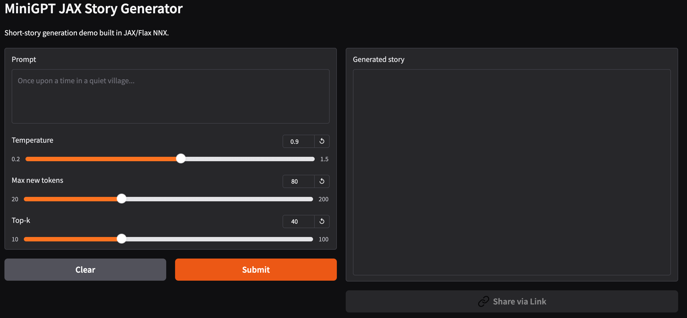

# MiniGPT-JAX for Short Story Generation

A MiniGPT-style autoregressive language model built in JAX/Flax NNX and trained on 200k short stories.

## Highlights
- Built a GPT-style decoder-only transformer from scratch in JAX
- Optimized training for Kaggle free-tier hardware
- Reduced training bottlenecks with offline tokenization and memory-mapped batches
- Logged throughput, validation loss, and generated samples

## Results
- Dataset: 200,000 short stories
- Model: 6-layer decoder-only transformer, 6 heads, embedding size 192, MLP size 768, context length 128, GPT-2 tokenizer (see [`config.json`](config.json))
- Hardware: Kaggle free-tier GPU
- Training: 15 epochs (about 8 minutes each, ~2 hours in total) at ~55,000 tokens/s
- **Validation loss 2.67 after epoch 1 → 1.65 after epoch 15** (perplexity ≈ 5.2); training loss 1.45, so the model is not badly overfitting
- Key improvement: pretokenization + streamlined JAX training loop

The full training log is in [`notebooks/gpt-mini-jax.ipynb`](notebooks/gpt-mini-jax.ipynb).

## 🚀 Live Demo

Try the app here: [Mini Story Generator on Hugging Face Spaces](https://huggingface.co/spaces/sajilck/mini_story_generator)

## Lessons Learned
- Python-side tokenization can dominate wall-clock time
- JIT alone is not enough without an efficient input pipeline
- Throughput tracking is essential for practical training work

## Future Work
- Flash attention or scaled-dot-product attention optimization
- Evaluation on held-out prompts beyond validation loss and perplexity